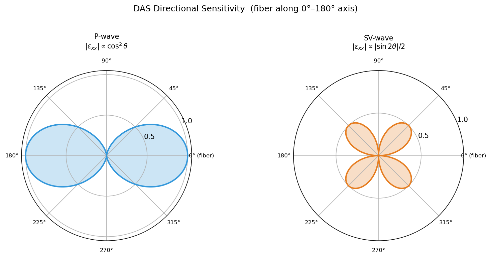
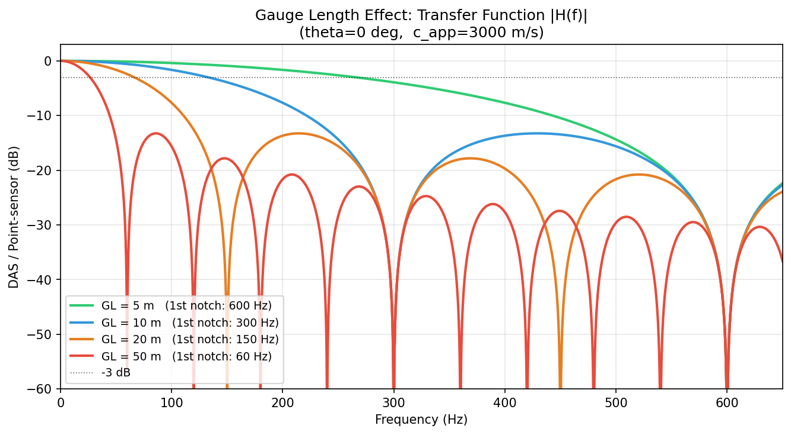
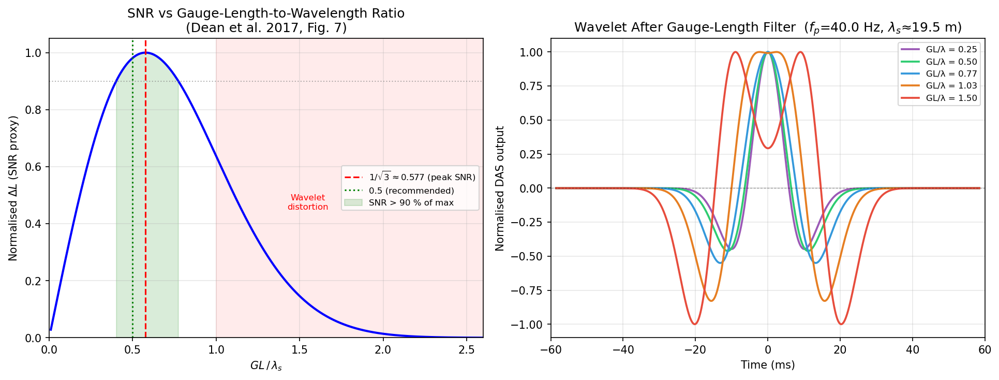
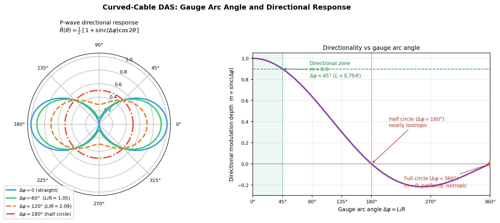

# DAS – Distributed Acoustic Sensing

## Introduction

**Distributed Acoustic Sensing (DAS)** is a fiber-optic seismic sensing technology that converts an ordinary optical fiber cable into a continuous, dense seismic array. A single fiber tens of kilometers long can simultaneously provide tens of thousands of virtual sensors with channel spacings as small as 1 m and sampling rates of several kHz.

Compared with conventional seismometers, DAS offers three core advantages:

| Feature | Conventional geophone | DAS |
|---------|----------------------|-----|
| Deployment cost | Each sensor installed separately | Cable laid in one pass |
| Spatial density | Limited stations (tens–hundreds) | Thousands to tens of thousands of channels |
| Low-frequency limit | Sensor dependent | Set by interrogation, drift, filtering and noise; no universal DC guarantee |
| Environment | Requires power, waterproofing | All-optical passive; can use submarine cables |

DAS measures the **dynamic axial strain** (or strain rate) along the fiber, not particle velocity. This fundamental difference gives rise to its distinctive directional response pattern and gauge length effect.

---

## Basic Principle

### Rayleigh Scattering and Phase-Sensitive OTDR

DAS operates by combining **Rayleigh backscattering** in optical fiber with **phase-sensitive Optical Time Domain Reflectometry (φ-OTDR)**:

1. **Pulse injection**: A coherent laser pulse is sent into the fiber (pulse width sets spatial resolution).
2. **Rayleigh backscattering**: Along the fiber, light scatters from random refractive-index inhomogeneities; a fraction returns to the interrogator.
3. **Phase detection**: The interrogator coherently demodulates the returned light to measure the **phase** of backscattered light at each depth.
4. **Phase → strain**: Phase shifts are proportional to changes in optical path length, i.e., to axial strain.

$$
\Delta\phi = \frac{4\pi n}{\lambda} \cdot \Delta L
$$

where $n$ is the fiber refractive index, $\lambda$ is the laser wavelength, and $\Delta L$ is the change in physical path length caused by strain.

!!! note "What DAS Measures"
    DAS measures the **axial dynamic strain** $\varepsilon_{xx}$ (or strain rate $\dot{\varepsilon}_{xx}$) along the fiber—that is, relative elongation/compression along the fiber axis. The response to seismic waves depends strongly on the angle between the wave propagation direction and the fiber axis.

### Key System Parameters

| Parameter | Typical values | Description |
|-----------|---------------|-------------|
| Channel spacing | 1–10 m | Distance between adjacent virtual sensors |
| Gauge length (GL) | 5–50 m | Strain integration length; governs spatial resolution and SNR |
| Sampling rate | 1–10 kHz | Temporal resolution |
| Maximum cable length | 10–100 km | Limited by laser power and fiber attenuation |
| Dynamic range | ~80–100 dB | Related to laser coherence |

---

## Typical Applications

### Vertical Seismic Profiling (VSP)

The first large-scale application of DAS in oil and gas exploration was **Vertical Seismic Profiling (VSP)**. Fiber cables cemented behind well casing record seismic wavefields over hundreds of meters depth simultaneously.

- **Advantages**: No repeated tripping; covers the entire well at high resolution.
- **Typical gauge length**: 5–10 m.
- **Signal types**: Direct P/S waves, reflections, converted waves.

### Urban Shallow Subsurface Imaging

Fiber cables in urban telecommunications conduits (existing infrastructure) use **ambient noise** from traffic and machinery as passive seismic sources to invert for shallow S-wave velocity structure.

- Representative work: Lindsey et al. (2017) imaged subsurface structure under the Stanford campus using telecom fiber.
- No active source required; near-zero marginal cost.

### Submarine Seismic Monitoring

**Existing submarine communication cables** serve as seismic sensors, filling the large gaps in ocean-bottom seismic networks.

- Detects microearthquakes, submarine landslides, and tsunami precursors.
- Representative work: Marra et al. (2018, *Science*) used a transatlantic cable to detect earthquakes.

### Microseismic and Induced Seismicity Monitoring

In geothermal energy, hydraulic fracturing, and CO₂ storage, DAS provides real-time monitoring of **microseismic activity** to track fracture propagation and induced seismicity.

---

## Sensitivity to Incident Angles

### Geometry

Let the fiber lie along the $x$-axis. A seismic plane wave propagates in the $x$–$z$ plane, with its propagation direction making angle $\theta$ to the fiber axis.

Wave vector:

$$
\mathbf{k} = k(\cos\theta\,\hat{x} + \sin\theta\,\hat{z}), \quad k = \frac{2\pi f}{c}
$$

Component along the fiber: $k_x = k\cos\theta$.

DAS measures axial strain $\varepsilon_{xx} = \partial u_x / \partial x$.

### P-Wave Directional Response

P-wave particle displacement is parallel to the propagation direction:

$$
\mathbf{u} = A\hat{k}\,e^{i(\mathbf{k}\cdot\mathbf{x} - \omega t)}
= A(\cos\theta\,\hat{x} + \sin\theta\,\hat{z})\,e^{i(k_x x + k_z z - \omega t)}
$$

The $x$-component: $u_x = A\cos\theta \cdot e^{i(\cdots)}$

Axial strain:

$$
\varepsilon_{xx}^{P} = \frac{\partial u_x}{\partial x} = ik_x A\cos\theta \cdot e^{i(\cdots)} = ik\cos\theta \cdot A\cos\theta \cdot e^{i(\cdots)}
$$

Therefore:

$$
\boxed{|\varepsilon_{xx}^{P}| \propto \cos^2\theta}
$$

- $\theta = 0°$ (wave propagates along fiber): **maximum response**
- $\theta = 90°$ (wave propagates perpendicular to fiber): $\varepsilon_{xx} = 0$, **no response**

### SV-Wave Directional Response

SV-wave particle displacement is perpendicular to the propagation direction, within the $x$–$z$ plane:

$$
\mathbf{u} = A(-\sin\theta\,\hat{x} + \cos\theta\,\hat{z})\,e^{i(k_x x + k_z z - \omega t)}
$$

The $x$-component: $u_x = -A\sin\theta \cdot e^{i(\cdots)}$

Axial strain:

$$
\varepsilon_{xx}^{SV} = \frac{\partial u_x}{\partial x} = ik_x(-A\sin\theta) = -ik\cos\theta \cdot A\sin\theta
$$

Therefore:

$$
\boxed{|\varepsilon_{xx}^{SV}| \propto |\sin\theta\cos\theta| = \frac{1}{2}|\sin 2\theta|}
$$

- $\theta = 0°$ or $\theta = 90°$: zero response
- $\theta = 45°$: **maximum response**

!!! note "SH-Wave Blind Spot"
    SH-wave particle displacement is perpendicular to the $x$–$z$ plane (along $y$), producing no $x$-direction displacement component. DAS is therefore **completely insensitive** to SH waves when the fiber lies in the $x$–$z$ plane. This is an inherent limitation.

### Directional Sensitivity Polar Diagram

Taking $\theta$ as the polar angle and $|\varepsilon_{xx}|$ as the radius, the polar diagrams for P-wave ($\cos^2\theta$) and SV-wave ($|\sin 2\theta|/2$) responses are shown in Figure 1.


*Figure 1: Polar diagrams of DAS directional sensitivity for P-waves (blue) and SV-waves (orange). Shaded area represents relative response amplitude. The fiber axis lies along the horizontal (0°–180°).*

---

## Flat Frequency Response

### Strain-to-Particle-Velocity Conversion

DAS measures axial strain, while seismology conventionally works with particle velocity. Their relationship determines DAS's frequency characteristics.

For a plane P-wave propagating along $x$ with displacement $u_x = A e^{i(kx - \omega t)}$:

$$
v_x = \frac{\partial u_x}{\partial t} = -i\omega A e^{i(\cdots)}
$$

$$
\varepsilon_{xx} = \frac{\partial u_x}{\partial x} = ikA e^{i(\cdots)} = \frac{ik}{-i\omega} \cdot v_x = -\frac{k}{\omega} v_x = -\frac{v_x}{c_P}
$$

Including the directional factor $\cos^2\theta$ for a general incident angle $\theta$:

$$
\varepsilon_{xx} = -\frac{\cos^2\theta}{c_P} \cdot v_P
$$

Solving for particle velocity:

$$
\boxed{v_P = -\frac{c_P}{\cos^2\theta} \cdot \varepsilon_{xx}}
$$

**Key property: the conversion factor $c_P / \cos^2\theta$ is frequency-independent.**

### Why It Is Called "Flat Response"

This frequency independence gives DAS a **flat frequency response** — unlike traditional geophones:

| Instrument | Measures | Frequency response | Low-frequency behavior |
|------------|----------|-------------------|----------------------|
| Short-period geophone | Particle velocity | Flat above $f_0$, rolls off below | 12 dB/octave roll-off below natural frequency |
| Accelerometer | Particle acceleration | Flat below resonance | Requires integration for velocity |
| **DAS (strain)** | **Axial strain** | Frequency-independent strain/velocity factor for a fixed plane wave in the long-wavelength limit | Actual low-frequency capability depends on interrogation, drift, filtering and noise |

!!! tip "Practical Significance"
    The constant conversion assumes known wave type, phase speed and incidence, a gauge much shorter than the along-cable wavelength, and controlled mechanical/instrument response. The gauge sinc is not exactly flat even below its first notch; surface-wave speed and polarization can vary with frequency. This does not imply universal DC response or a single conversion constant for arbitrary wavefields.

!!! warning "Strain vs. Strain Rate"
    Many DAS systems output **strain rate** $\dot{\varepsilon}$ (time derivative of strain) rather than strain. Strain rate relates to particle velocity as $\dot{\varepsilon} = -(\cos^2\theta / c_P) \cdot \dot{v}_P$, i.e., proportional to **acceleration** — not flat in velocity. To recover the flat velocity response, integrate in time (divide by $i\omega$ in the frequency domain) to obtain strain first.

---

## Gauge Length Effect

### Spatial Integration Filter

DAS does not measure strain at a true point. Instead, it measures the phase difference between the two ends of a gauge-length segment of length $L$, equivalent to **spatial averaging** of the strain over that segment:

$$
\varepsilon_\mathrm{GL}(x_0, t) = \frac{u_x(x_0 + L/2,\, t) - u_x(x_0 - L/2,\, t)}{L}
$$

### Transfer Function Derivation

For a plane wave $u_x = A e^{i(k_x x - \omega t)}$:

$$
\varepsilon_\mathrm{GL} = \frac{Ae^{ik_x(x_0+L/2)} - Ae^{ik_x(x_0-L/2)}}{L} \cdot e^{-i\omega t}
= \frac{2i\sin(k_x L/2)}{L} \cdot Ae^{ik_x x_0} e^{-i\omega t}
$$

Since the point strain is $\varepsilon_\mathrm{point} = ik_x Ae^{ik_x x_0}e^{-i\omega t}$, the gauge-length transfer function is:

$$
H(k_x) = \frac{\varepsilon_\mathrm{GL}}{\varepsilon_\mathrm{point}} = \frac{\sin(k_x L/2)}{k_x L/2} = \mathrm{sinc}\!\left(\frac{k_x L}{2\pi}\right)
$$

In terms of frequency (substituting $k_x = 2\pi f \cos\theta / c$):

$$
\boxed{H(f, \theta) = \mathrm{sinc}\!\left(\frac{f L \cos\theta}{c}\right)}
$$

### Notch Frequencies

The sinc function is zero at $k_x L/2 = n\pi$ ($n = 1, 2, 3, \ldots$), giving **notch frequencies**:

$$
f_n = \frac{n \cdot c}{L\cos\theta} = \frac{n \cdot c_\mathrm{app}}{L}
$$

where $c_\mathrm{app} = c/\cos\theta$ is the **apparent velocity** along the fiber.

!!! note "Physical Interpretation"
    When the apparent wavelength along the fiber $\lambda_\mathrm{app} = c_\mathrm{app}/f$ equals the gauge length $L$ (i.e., $f = c_\mathrm{app}/L$), displacements at the two gauge endpoints are **equal in magnitude but opposite in sign**, so their difference is exactly zero — producing the first notch.

### Gauge Length Trade-offs

| Gauge length $L$ | First notch $f_1$ ($c$ = 3000 m/s, $\theta$ = 0°) | SNR |
|------------------|----------------------------------------------------|-----|
| 5 m | 600 Hz | Low (short integration) |
| 10 m | 300 Hz | Medium |
| 20 m | 150 Hz | Higher |
| 50 m | 60 Hz | High, but significant high-frequency loss |

!!! warning "Gauge Length Selection Is Critical"
    A gauge length that is too large lowers the notch frequency, causing high-frequency signal loss. Too small a gauge length reduces the per-channel SNR. In practice, $L = 5$–$20$ m is typical, chosen based on the target signal band and deployment geometry.

The angular dependence: larger $\theta$ (wave more perpendicular to fiber) → smaller $k_x$ → higher notch frequency (better high-frequency preservation), but weaker amplitude (smaller $\cos^2\theta$ factor).


*Figure 2: DAS transfer function $|H(f)|$ for different gauge lengths ($\theta = 0°$, $c = 3000$ m/s). Larger gauge lengths shift the first notch to lower frequencies.*

### Optimum Gauge Length: SNR–Resolution Trade-off

The analysis above reveals two opposing effects: **too short a gauge length → poor SNR; too long a gauge length → reduced resolution and wavelet distortion**. Dean, Cuny & Hartog (2017) provide a quantitative treatment for axially incident P-waves ($\theta = 0°$, the VSP geometry).

#### SNR Analysis

For a P-wave propagating along the fiber axis, the strain waveform is a spatial **Ricker wavelet**:

$$
\varepsilon(x) = \left(1 - 2\pi^2 k^2 x^2\right) e^{-\pi^2 k^2 x^2}, \quad k = \frac{\pi f_p}{v}
$$

The total fiber length change $\Delta L$ measured by DAS is the integral of strain over the gauge length:

$$
\Delta L = \int_{-L/2}^{L/2} \varepsilon(x)\,\mathrm{d}x = L\, e^{-\pi^2 k^2 (L/2)^2}
$$

The phase measurement error $E(\Delta L)$ is independent of gauge length (determined by laser coherence), so **SNR ∝ $\Delta L$**. Maximizing $\Delta L$ with respect to $L$:

$$
\boxed{L_\mathrm{SNR} = \frac{\lambda_s}{\sqrt{3}} \approx 0.577\,\lambda_s}
$$

where the spatial wavelength is $\lambda_s = v\lambda_t = v\sqrt{6}/(\pi f_p)$.

#### Resolution Analysis — Wavelet Distortion Modes

The gauge-length integration acts as a **box-car (moving-average) filter**, whose frequency response is the sinc function. As $L$ increases, the notch frequency moves into the signal band:

| GL/$\lambda_s$ ratio | Wavelet state | SNR |
|---------------------|---------------|-----|
| $< 0.40$ | Normal, high resolution | Low (weak signal) |
| $0.40$–$0.54$ | **Optimal zone**: high SNR + good resolution | > 90 % of maximum |
| $\approx 0.577$ | Peak SNR; slight wavelet broadening | Maximum |
| $\approx 1.0$ | Notch enters main bandwidth; **flat-topped** wavelet | High but poor resolution |
| $> 1.0$ | **Double-lobed** (two peaks) wavelet; severe distortion | Avoid |

#### Optimum Gauge Length Formula

Combining SNR > 90% of maximum and wavelength error < 15%, the optimal ratio is $GL/\lambda_s \approx 0.40$–$0.54$; the recommended value is 0.5, giving (Dean et al. 2017, eq. 18):

$$
\boxed{L_\mathrm{opt} = \frac{\mathrm{ratio} \times v}{f_p} \approx \frac{0.5\,v}{f_p} = \frac{\lambda_s}{2}}
$$

!!! tip "Practical Example"
    In a VSP survey, a zone with apparent velocity $v = 3000$ m/s and peak frequency $f_p = 50$ Hz:
    $$L_\mathrm{opt} \approx \frac{0.5 \times 3000}{50} = 30\text{ m}, \quad \lambda_s \approx 46.8\text{ m}$$
    If apparent velocities range from 2900 to 5900 m/s over the full well, **apply different optimum gauge lengths at different depths** to maintain optimal SNR and resolution throughout.

!!! warning "Hardware Lower Bound"
    Gauge length, optical pulse width, spatial response and phase noise must be considered together. An 8 m scale describes some configurations, not a universal physical lower bound. Use the instrument specification and measured response.


*Figure 3: Left — normalised $\Delta L$ (SNR proxy) vs $GL/\lambda_s$; the green region marks SNR > 90 % of the maximum, and the red region marks the wavelet-distortion zone. Right — normalised DAS wavelet output for five GL/$\lambda_s$ ratios ($f_p$ = 40 Hz, $v$ = 1000 m/s, $\lambda_s \approx$ 19.5 m). After Dean et al. (2017).*

---

## Combined Instrument-Response Model

Fix the input and output quantities first. Let $U(f)$ denote the local P-wave **particle-displacement complex spectrum** along propagation, using $e^{i(\mathbf k\cdot\mathbf x-\omega t)}$, $\omega=2\pi f$, phase speed $c_P$, and angle $\theta$ between propagation and a straight cable. The gauge-averaged strain-rate response is

$$
\boxed{\dot E_{\rm GL}(f)=
\frac{\omega^2\cos^2\theta}{c_P}
\underbrace{\mathrm{sinc}\!\left(\frac{fL\cos\theta}{c_P}\right)}_{H_{\rm GL}(f,\theta)}
U(f)}
$$

Throughout this response model, $\mathrm{sinc}(x)=\sin(\pi x)/(\pi x)$. The corresponding strain is $E_{\rm GL}=i\omega\cos^2\theta\,H_{\rm GL}U/c_P$. With particle velocity $V=-i\omega U$, it becomes $E_{\rm GL}=-(\cos^2\theta/c_P)H_{\rm GL}V$. Thus a frequency-independent strain/velocity proportionality under fixed plane-wave conditions is consistent with frequency factors in the strain/displacement conversion.

| Quantity | Factor relative to displacement $U$ | Output units |
|---|---|---|
| Strain $E_{\rm GL}$ | $i\omega\cos^2\theta H_{\rm GL}/c_P$ | Dimensionless |
| Strain rate $\dot E_{\rm GL}$ | $\omega^2\cos^2\theta H_{\rm GL}/c_P$ | $\mathrm{s}^{-1}$ |
| Strain/velocity $E_{\rm GL}/V$ | $-\cos^2\theta H_{\rm GL}/c_P$ | $\mathrm{s/m}$ |

For a plane S wave, replace $\cos^2\theta$ by $(\mathbf t\cdot\mathbf n)(\mathbf t\cdot\mathbf p)$ and $c_P$ by $c_S$, where $\mathbf t$, $\mathbf n$ and $\mathbf p$ are the cable tangent, propagation and polarization unit vectors. The absolute angular factor for two-dimensional SV geometry is $|\sin\theta\cos\theta|$. Surface waves, deviated wells and mixed modes require the full strain projection; see [borehole Rayleigh-wave observations](borehole-rayleigh-en.md).

If $U$ is further decomposed into source, geometrical spreading, path attenuation and site terms, define each convention. Separate factors $e^{-\pi f\kappa}$ and $e^{-\pi f t^*}$ can be multiplied only if they represent **non-overlapping path contributions**; otherwise near-surface attenuation is counted twice.

!!! note "Depth Differential in Borehole DAS"
    The local plane-wave phase travel-time difference is the projection of slowness onto the cable:
    $$\mathrm{d}t=\frac{\cos\theta}{c}\,\mathrm{d}s,\qquad c_{\rm app}=\frac{c}{|\cos\theta|}.$$
    Only a vertical straight well permits $\mathrm{d}s=\mathrm{d}z$. For a deviated well use the three-dimensional trajectory. This is the arrival-time difference of one wavefront at two channels, not the time to travel a ray-path distance $\mathrm{d}z/\cos\theta$.

### Incident Angle Constraint on Response Corrections

Response correction must match the physical output quantity and retain mechanical-transfer uncertainty. Direct division is unstable near a directional zero or gauge notch.

| Factor | Small angle $\theta\ll45^\circ$ | Large angle $\theta\to90^\circ$ |
|---|---|---|
| Directional inverse $1/\cos^2\theta$ | Near 1 | Diverges and amplifies noise |
| First gauge notch $c/(L|\cos\theta|)$ | Near $c/L$ | Moves to **higher** frequency |
| Strain/velocity sensitivity $\cos^2\theta/c$ | Near $1/c$ | Approaches zero |

A conservative analysis might use $\theta<45^\circ$, but this is a study choice, not a universal threshold. Determine a usable range from SNR, angle uncertainty, transfer response and the target band.

!!! tip "Geometry for Vertical Wells"
    For straight rays in a homogeneous medium, a channel at depth $z_{\rm ch}$ and an event at horizontal offset $r_H$ and depth $z_{\rm src}>z_{\rm ch}$ give
    $$\theta=\arctan\!\left(\frac{r_H}{z_{\rm src}-z_{\rm ch}}\right).$$
    The angular selection $\theta<45^\circ$ then requires $r_H<z_{\rm src}-z_{\rm ch}$. In layered media, ray tracing determines the **local** incidence; source-to-channel straight-line geometry is only an approximation.

---

## Cable Coupling

The formation-to-fibre response involves at least two mechanical interfaces:

$$
\varepsilon_{\rm formation}
\xrightarrow{C_{\rm med}(f)}
\varepsilon_{\rm jacket}
\xrightarrow{\eta_{\rm fiber}(f)}
\varepsilon_{\rm fiber}.
$$

These are generally complex transfer functions depending on frequency, wavelength and boundary conditions. Resonance, guided waves and differences between the reference and local field can produce apparent amplification; do not assume constant real coefficients below one. A single DAS record generally cannot separate both interfaces.

### Jacket-to-Fiber Coupling

#### Cable Structure and Strain Transfer Efficiency

**Loose-tube cable.** Excess fibre length and soft filling compounds alter transfer, but gel can transmit shear at small amplitudes. Loose-tube telecom cables can record earthquakes; they are not automatically unusable or zero-response sensors. Distinguish waveform detection, travel-time analysis and accurate amplitude measurement. [Reinsch et al. (2017)](https://doi.org/10.1088/1361-6501/aa8ba4), [Forbriger et al. (2025)](https://doi.org/10.1785/0220240308)

**Tight-buffered cable.** Direct buffering usually favours transfer, but it does not guarantee unit response:

$$
E_{\rm fiber}(f)=\eta_{\rm fiber}(f,k)\,E_{\rm jacket}(f).
$$

Material properties, wavelength, temperature, tension and installation can change amplitude and phase.

**Strain-sensing cables.** Reinforced buffering, bonded fibres or other sensing-oriented constructions are engineered for strain transfer. Performance still needs to be checked under the actual field conditions.

| Cable type | Relevant controls | Evaluation requirement |
|---|---|---|
| Loose-tube | Gel, excess length, wavelength | Verify detection and transfer; do not reject by name alone |
| Tight-buffered | Buffer and bond properties | Calibrate within the target band |
| Sensing-oriented | Manufacturer's specified conditions | Check compatibility with field loading |
| Armoured | Internal structure and external contact | Evaluate both interfaces |

!!! warning "The telecom cable reuse trap"
    Obtain cable cross-sections, filling material, excess length and installation records. Cable labels alone cannot supply a universal transfer coefficient or determine suitability.

#### Frequency-Domain Jacket-to-Fiber Coupling Model

Define the transfer by its input and output:

$$
\eta_{\rm fiber}(f,k)=\frac{E_{\rm fiber}(f,k)}{E_{\rm jacket}(f,k)}.
$$

Layered shear-transfer models solve axial equilibrium and interface shear with specified moduli, radii, wavelength and boundary conditions. A single empirical time constant cannot replace the cable mechanics. Treat $\eta_{\rm fiber}$ as constant only after target-band validation. A field reference usually constrains the product of internal and external transfer, rather than the internal coefficient alone.

### Cable-to-Medium Coupling

#### Physical Mechanism

Interface stiffness, damping, friction and contact geometry determine how ground motion enters the cable. Perfect bonding and free slip are ideal limits, not labels guaranteed by installation records.

An **empirical first-order low-pass** may describe a measured smooth roll-off:

$$
C_{\rm med}^{\rm emp}(f)=\frac{C_0}{1-i f/f_c}.
$$

Its high-frequency magnitude decreases at $-20$ dB/decade. This is not a universal coupling law. In contrast, a simple base-driven damped spring–mass displacement model gives

$$
\frac{X_c(\omega)}{X_g(\omega)}
=\frac{k_s-i\omega b_s}{k_s-m_c\omega^2-i\omega b_s},
\qquad f_n=\frac{1}{2\pi}\sqrt{\frac{k_s}{m_c}}.
$$

Here $m_c$ is mass per unit length and $b_s$ is viscous damping per unit length. The natural frequency $f_n$ is not automatically the corner $f_c$ of a first-order low-pass. This model illustrates damping and resonance; strain transfer additionally needs spatial shear and internal structure. [Reinsch et al. (2017)](https://doi.org/10.1088/1361-6501/aa8ba4)

#### Four Deployment Scenarios

**Cemented borehole**

Continuous grout can improve contact. A scale estimate for an ideal coaxial elastic annulus is $k_s\sim2\pi G_g/\ln(r_{\rm bh}/r_c)$, where $G_g$ is grout shear modulus and the radii describe the borehole and cable. Voids, debonding, casing and internal transfer remain relevant; cementing does not prove perfect response throughout the seismic band.

**Frozen into ice or permafrost**

Refreezing around a cable can improve contact. Transfer still depends on freezing completeness, fractures, cable structure and frequency. Freeze–thaw cycles and local separation require monitoring.

**Buried in soil**

An idealized stiffness scale $k_s\sim2\pi G_s/\ln(D_\infty/r_c)$ depends on soil shear modulus and an assumed influence radius. It does not determine a universal burial-depth/corner-frequency table. Compaction, water content, confining pressure and workmanship all matter. Fine- and coarse-sand sections commonly differ in depth and formation as well; their response difference alone cannot establish a grain-size effect.

**Surface-laid cable**

Self-weight, friction, tension, curvature and roughness determine contact. Pins, bags or burial can improve SNR or observation range, but their amplitude-transfer benefit must be tested.

!!! warning "Submarine telecom cables for DAS"
    Subsea cables can be buried, exposed or suspended; there is no universal 20 Hz usable-band limit. Marra et al. (2018) used integrated laser interferometry, not channel-resolved Rayleigh-DAS amplitude calibration. Separate ground-strain transfer from hydrodynamic forcing and cable vibration.

!!! note "Calibration is stronger evidence than a universal coefficient table"
    Forbriger et al. (2025) measured total transfer rates of about 0.13–0.53 at 0.05–0.1 Hz using independent strainmeters, despite high waveform similarity. This is a site-specific result, not a universal range for cable types.

### Updated Combined Instrument Response

For a locally linear, approximately separable P-wave response,

$$
\boxed{\dot E_{\rm obs}(f)=H_{\rm IU}(f)\,C_{\rm med}(f)\,\eta_{\rm fiber}(f)
\frac{\omega^2\cos^2\theta}{c_P}
\mathrm{sinc}\!\left(\frac{fL\cos\theta}{c_P}\right)U(f)+N(f)}
$$

$H_{\rm IU}$ represents interrogation and processing response, and $N$ is additive noise. Unknown source, site and transfer contributions may compensate each other.

| Factor | Control or constraint | Residual uncertainty |
|---|---|---|
| $C_{\rm med}$ | Installation and contact | Voids, local geology and friction |
| $\eta_{\rm fiber}$ | Cable design | Materials, temperature and ageing |
| $\cos^2\theta/c_P$ | Incidence and velocity | Geometry, polarization and model error |
| $H_{\rm GL}$ | Gauge length | Spatial weighting and trajectory |

!!! tip "Coupling correction order before inversion"
    1. Confirm strain versus strain rate, units, filtering, gauge length and channel geometry.
    2. Evaluate SNR, transfer, directional zeros and gauge notches in the target band.
    3. Apply regularized correction only where supported, with reference and error sensitivity; mark near-zero response as poorly identifiable.
    4. Do not interpret compensation between receiver gain, source spectrum and path attenuation as a unique solution.

### In-Situ Coupling Assessment

Convert DAS and reference records into the same quantity, direction and comparable spatial averaging before estimating a transfer. For reference axial strain $x$, DAS strain $y$, and cross-spectrum convention $S_{yx}=\langle YX^*\rangle$,

$$
\hat T(f)=\frac{S_{yx}(f)}{S_{xx}(f)+\lambda(f)},\qquad
\gamma^2(f)=\frac{|S_{yx}(f)|^2}{S_{xx}(f)S_{yy}(f)}.
$$

The stabilizer $\lambda$ limits unstable division; noise in the reference still causes estimation bias. High coherence supports a linear waveform relation, not unit gain. If $y=0.2x$ without noise, $\gamma^2=1$ but transfer magnitude is 0.2. Seismometer velocity-to-strain conversion requires wave type, apparent slowness and polarization; independent multi-direction strainmeters provide a more direct strain reference. Roll-off can also arise from the instrument, gauge averaging and site response, so slope alone cannot identify contact stiffness. [Forbriger et al. (2025)](https://doi.org/10.1785/0220240308), [Muir and Zhan (2022)](https://doi.org/10.1093/gji/ggab439)

!!! tip "No reference station? Detect coupling from the data itself"
    Neighbour coherence, spectral fingerprints and repeated-event stability support **relative screening and channel selection**, not automatic absolute mechanical-transfer calibration. See [coupling assessment and validation](cable-coupling-en.md) and [field workflow](field-workflow-en.md).

---

## Curved Cables: Curvature and Gauge-Length Selection

The directional response and gauge-length analyses above all assume a **straight** fibre. In practice cables are often curved — ring arrays, helical winding, road corners, routing around obstacles — and a single gauge length $L$ then spans an **arc** over which the fibre tangent direction rotates. Both the directional pattern and the gauge filter change as a result.

### Gauge Arc Angle: the Key Dimensionless Parameter

For a local curvature radius $R$ (the ring radius for a circular cable), the gauge length subtends a central angle (**gauge arc angle**):

$$
\boxed{\Delta\varphi = \frac{L}{R}}
$$

This single dimensionless parameter controls curved-cable DAS behaviour:

- $\Delta\varphi \to 0$: the gauge is locally straight; the straight-cable theory applies
- Increasing $\Delta\varphi$: the tangent rotates significantly within one gauge; the directional pattern is smeared
- $\Delta\varphi = 2\pi$: the gauge wraps a full circle; the response is perfectly isotropic

### Arc-Averaged Directional Response

For a P wave arriving at azimuth $\theta$ (measured from the tangent at the arc midpoint), the local tangent at arc-length coordinate $s$ is rotated by $\varphi(s) = s/R$, $s \in [-L/2, L/2]$. The DAS channel output averages the axial strain over the gauge:

$$
\bar{R}(\theta) = \frac{1}{L}\int_{-L/2}^{L/2} \cos^2\!\big(\theta - \varphi(s)\big)\, \mathrm{d}s
$$

Substituting $\cos^2 x = \tfrac{1}{2}(1+\cos 2x)$ and integrating gives the closed form:

$$
\boxed{\bar{R}(\theta) = \frac{1}{2}\Big[1 + \mathrm{sinc}(\Delta\varphi)\cos 2\theta\Big]},
\qquad \mathrm{sinc}(x) = \frac{\sin x}{x}
$$

where $m = \mathrm{sinc}(\Delta\varphi)$ is the **directional modulation depth**:

| $\Delta\varphi$ | $m = \mathrm{sinc}(\Delta\varphi)$ | Pattern |
|------------------|-----------------------------------|---------|
| 0° (straight) | 1.000 | Standard $\cos^2\theta$ two-lobe |
| 45° | 0.900 | Nearly straight-cable, slightly blunted lobes |
| 90° | 0.637 | Visibly broadened lobes |
| 180° (half circle) | 0.000* | Nearly isotropic |
| 360° (full circle) | 0.000 | Perfectly isotropic, $\bar{R} \equiv 1/2$ |

*$\mathrm{sinc}(\pi) = 0$ exactly.

!!! note "Directionality: feature or bug?"
    - **When direction matters** (beamforming, back-azimuth estimation): curvature is **harmful** — the smeared pattern broadens the slowness-spectrum main lobe and degrades location accuracy
    - **When omnidirectional coverage matters** (event detection, amplitude monitoring): curvature is **beneficial** — channels with arc angles above a half circle respond almost isotropically, removing the straight-cable blind spot for broadside arrivals ($\cos^2 90° = 0$)

### Gauge-Length Selection Under Curvature

**Criterion 1 — preserve directionality** (beamforming, F-K analysis, moment-tensor inversion)

Require modulation depth $m > 0.9$:

$$
\boxed{\Delta\varphi < 45° \iff L < 0.79\, R}
$$

**Criterion 2 — combine with the straight-cable optimum** (Dean et al. 2016)

Straight-cable analysis gives the SNR-optimal gauge $L_\text{opt} \approx 0.577\,\lambda_s$ ($\lambda_s$ = shortest target wavelength). Intersecting with the curvature constraint:

$$
\boxed{L = \min\big(0.577\,\lambda_s,\ 0.79\,R\big)}
$$

- For $R > 0.73\,\lambda_s$ curvature is not binding — use the straight-cable rule
- For small $R$ (compact ring arrays) the curvature constraint dominates, forcing a shorter gauge → SNR loss, compensated by stacking multiple channels

**Criterion 3 — deliberate isotropy** (omnidirectional detection)

Set $\Delta\varphi \geq 180°$ (i.e. $L \geq \pi R$) so that single-channel patterns are nearly omnidirectional. The extreme case — gauge wrapping the full ring ($L = 2\pi R$) — measures the rate of change of ring circumference, i.e. the areal strain enclosed by the ring: the working principle of a **ring strain gauge**.


*Figure 5: (Left) P-wave directional response for several gauge arc angles — straight cable (blue) shows the standard cos²θ two-lobe pattern; lobes broaden with increasing arc angle; the half-circle case (red dash-dot) is nearly isotropic. (Right) Directional modulation depth $m = \mathrm{sinc}(\Delta\varphi)$ vs arc angle: the green zone ($\Delta\varphi < 45°$, i.e. $L < 0.79R$) preserves strong directionality ($m > 0.9$); $m$ vanishes exactly at the half circle and the response is perfectly isotropic for the full circle.*

### Effect of Curvature on the Gauge (Notch) Filter

For a straight cable the gauge-filter notch lies at $f_1 = v_\text{app}/L$ with $v_\text{app} = c/\cos\theta$. On a curved cable the local along-fibre apparent slowness varies along the arc, so:

1. **Shallower notches**: notch frequencies differ between arc segments; after averaging, the notch is no longer a perfect zero but a finite-depth trough
2. **Effective gauge shortening**: the projection of the gauge onto the propagation direction is the **chord**, not the arc:

$$
L_\text{chord} = 2R\sin\!\left(\frac{\Delta\varphi}{2}\right) < L
$$

For $\Delta\varphi = 90°$, $L_\text{chord} \approx 0.90\,L$; for $\Delta\varphi = 180°$, $L_\text{chord} = 2R \approx 0.64\,L$. Notch frequencies shift upward correspondingly, and the effective spatial resolution is slightly better than the arc-length prediction.

!!! tip "Practical notes for ring arrays"
    1. **Ring diameter**: urban well-pad ring deployments typically use $2R \sim 50$–$200$ m. With a 10 m gauge and $R = 25$ m, $\Delta\varphi \approx 23°$ and $m \approx 0.97$ — directionality essentially unaffected
    2. **Corner-channel rejection**: right-angle road corners can have curvature radii of 1–2 m; a 10 m gauge then spans $\Delta\varphi > 360°$ and the response is not analytically tractable. Standard practice is to **discard channels within ±L of each corner**
    3. **Fibre bend loss**: besides response distortion, small bend radii cause macrobend optical loss. Single-mode fibre requires $R \gtrsim 15$ mm and jacketed cables $R \gtrsim 10$–$20\times$ the cable diameter — metre-scale ring arrays are far from this limit, but splice boxes and slack coils need attention
    4. **Azimuthal diversity**: the intrinsic advantage of a ring — channel tangents sweep all 360° of azimuth, equivalent to a full set of single-component strainmeters at all orientations, which is particularly valuable for anisotropy inversion and source-mechanism constraints

---

## Python Example

The code below reproduces both figures: the directional sensitivity polar plot and the gauge-length transfer function.

```python
import numpy as np
import matplotlib.pyplot as plt

# ── Figure 1: Directional sensitivity polar plots ─────────
theta = np.linspace(0, 2 * np.pi, 720)
resp_P  = np.cos(theta) ** 2
resp_SV = np.abs(np.sin(2 * theta)) / 2

fig, axes = plt.subplots(1, 2, figsize=(11, 5),
                          subplot_kw=dict(projection='polar'))

for ax, resp, color, desc in [
    (axes[0], resp_P,  '#3498db',
     'P-wave\n' + r'$|\varepsilon_{xx}| \propto \cos^2\theta$'),
    (axes[1], resp_SV, '#e67e22',
     'SV-wave\n' + r'$|\varepsilon_{xx}| \propto |\sin 2\theta|/2$'),
]:
    ax.plot(theta, resp, color=color, lw=2)
    ax.fill(theta, resp, alpha=0.25, color=color)
    ax.set_theta_zero_location('E')
    ax.set_theta_direction(1)
    ax.set_xticks(np.deg2rad([0, 45, 90, 135, 180, 225, 270, 315]))
    ax.set_xticklabels(['0° (fiber)', '45°', '90°', '135°',
                         '180°', '225°', '270°', '315°'], fontsize=8)
    ax.set_yticks([0.5, 1.0])
    ax.set_title(desc, pad=14, fontsize=10)

plt.suptitle('DAS Directional Sensitivity  (fiber along 0°–180° axis)',
             y=1.02, fontsize=12)
plt.tight_layout()
plt.savefig('docs/assets/images/das_angle_response.png', dpi=150, bbox_inches='tight')

# ── Figure 2: Gauge length transfer function ──────────────
c   = 3000.0
GLs = [5, 10, 20, 50]
colors = ['#2ecc71', '#3498db', '#e67e22', '#e74c3c']
f = np.linspace(0.1, 650, 3000)

fig, ax = plt.subplots(figsize=(9, 5))
for L, color in zip(GLs, colors):
    kxL_half = np.pi * f * L / c
    H = np.abs(np.sinc(kxL_half / np.pi))
    ax.plot(f, 20 * np.log10(np.clip(H, 1e-6, None)),
            color=color, lw=2, label=f'GL = {L} m   (1st notch: {int(c/L)} Hz)')

ax.axhline(-3, color='k', lw=0.8, ls=':', alpha=0.6, label=r'$-3$ dB')
ax.set(xlabel='Frequency (Hz)', ylabel='DAS / Point-sensor (dB)',
       title=r'Gauge Length Effect: $|H(f)|$  ($\theta=0°$, $c_{\rm app}=3000$ m/s)',
       xlim=[0, 650], ylim=[-60, 3])
ax.legend(fontsize=9)
ax.grid(True, alpha=0.3)
plt.tight_layout()
plt.savefig('docs/assets/images/das_gauge_length.png', dpi=150, bbox_inches='tight')
plt.show()
```

---

## References

- Reinsch, T., Thurley, T., & Jousset, P. (2017). On the mechanical coupling of a fiber optic cable used for distributed acoustic/vibration sensing applications—a theoretical consideration. *Measurement Science and Technology*, 28, 127003. [DOI](https://doi.org/10.1088/1361-6501/aa8ba4).
- Forbriger, T., et al. (2025). Calibration of the Strain Amplitude Recorded with DAS Using a Strainmeter Array. *Seismological Research Letters*, 96, 2356–2367. [DOI](https://doi.org/10.1785/0220240308); [author full text](https://arxiv.org/html/2408.01151v3).
- Muir, J. B., & Zhan, Z. (2022). Wavefield-based evaluation of DAS instrument response and array design. *Geophysical Journal International*. [DOI](https://doi.org/10.1093/gji/ggab439).

- Lindsey, N. J., Martin, E. R., Dreger, D. S., Freifeld, B., White, S., Monga, S. K., … & Ajo-Franklin, J. B. (2017). Fiber-optic network observations of earthquake wavefields. *Geophysical Research Letters*, 44(23), 11–792.
- Mateeva, A., Lopez, J., Potters, H., Mestayer, J., Cox, B., Kiyashchenko, D., … & Berlang, W. (2014). Distributed acoustic sensing for reservoir monitoring with vertical seismic profiling. *Geophysical Prospecting*, 62(4), 679–692.
- Marra, G., Clivati, C., Luckett, R., Tampellini, A., Kronjäger, J., Wright, L., … & Margolis, H. S. (2018). Ultrastable laser interferometry for earthquake detection with terrestrial and submarine cables. *Science*, 361(6401), 486–490.
- Wang, H. F., Zeng, X., Miller, D. E., Fratta, D., Feigl, K. L., Thurber, C. H., & Mellors, R. J. (2018). Ground motion response to an ML 4.3 earthquake using co-located distributed acoustic sensing and seismometers. *Geophysical Journal International*, 213(3), 2020–2036.
- Daley, T. M., Miller, D. E., Dodds, K., Cook, P., & Freifeld, B. M. (2016). Field testing of modular borehole monitoring with simultaneous distributed acoustic sensing and geophone vertical seismic profiles at Citronelle, Alabama. *Geophysical Prospecting*, 64(5), 1318–1334.
- Zhan, Z. (2020). Distributed acoustic sensing turns fiber-optic cables into seismic stations. *Bulletin of the Seismological Society of America*, 110(3), 975–985.
- Dean, T., Cuny, T., & Hartog, A. H. (2017). The effect of gauge length on axially incident P-waves measured using fibre optic distributed vibration sensing. *Geophysical Prospecting*, 65(1), 184–193. https://doi.org/10.1111/1365-2478.12419
- Bakku, S. K. (2015). *Fracture characterization from seismic measurements in a borehole* (Doctoral dissertation, Massachusetts Institute of Technology).
- Chang, H., Nakata, N., Abercrombie, R. E., Dadi, S., & Titov, A. (2026, in review). Using borehole Distributed Acoustic Sensing to investigate microearthquake source parameter variability in an enhanced geothermal system. *ESSOAr preprint*. https://doi.org/10.22541/essoar.15002292/v1
